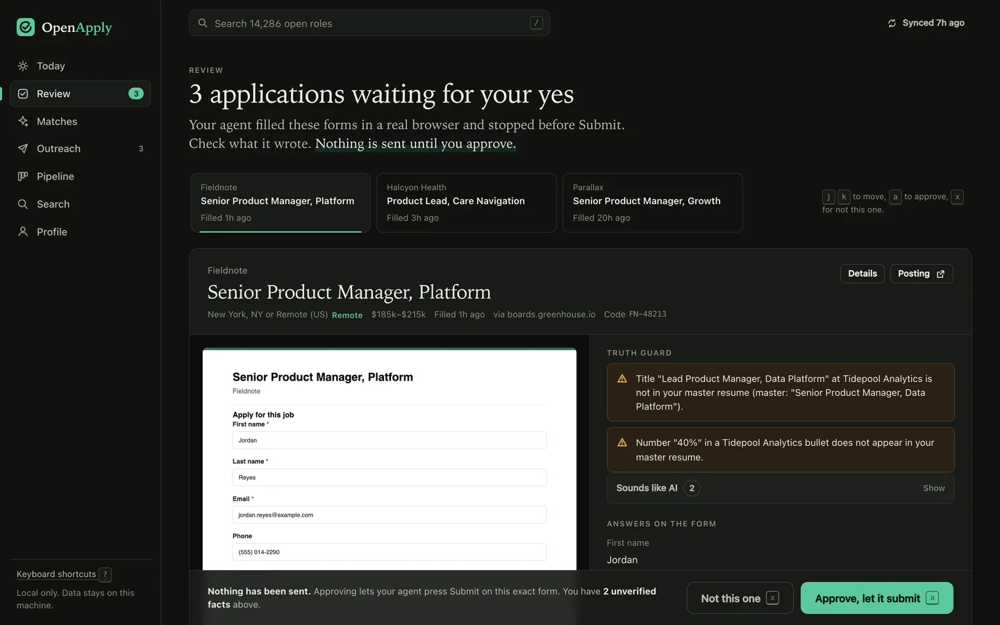

# OpenApply

A free, local, open-source job-search toolkit for your AI agent. Add it to Claude Code, Codex, Cursor or any MCP client and your agent can:

- **Find** open roles across 8,700+ company job boards (Greenhouse, Lever, Ashby, Workable, SmartRecruiters, Recruitee, Workday) plus free remote feeds and HN Who's Hiring, about 250k live roles, ranked against your profile.
- **Tailor** a resume, cover letter and answers per role, written by your agent's own model and checked against your master resume so nothing gets invented.
- **Apply** by opening the employer's real application form in a visible browser, filling every field it can, attaching the tailored PDFs, and stopping before Submit until you say yes.
- **Track** applications, recruiter outreach and follow-ups, with a local review dashboard.

No account, no API key, no subscription, no server. Everything lives in `~/.openapply` on your machine.

Website: https://noelturlington.xyz/openapply/



## Your data

Everything lives in `~/.openapply` on your machine: your profile, resume, application packs, screenshots, the job index and the browser profile. This repository holds no personal data. There is no account and no telemetry. The only network calls go to public job-board APIs and feeds (to build the index) and to the employer forms you open and fill. Delete the folder and it is all gone.

## Why it works differently

Paid "AI appliers" sell volume. Startup recruiters keep saying volume is the wrong lever: a person reads every answer, AI-polished applications all sound alike, and the candidates who get hired show they understand the business, bring proof of work, and reach the team directly. OpenApply is built around that:

| | |
|---|---|
| Truth guard | New numbers, employers, titles, schools, dates or skills in a tailored resume that are not in your master resume are flagged. |
| Voice guard | Flags AI-cliche phrasing ("I am thrilled", "passionate about", "leverage", "fast-paced environment"...) and generic letters that never name the company. Tailoring uses samples of your own writing. |
| You write the "why" | "Why this company" questions go back to you (or your saved story) instead of invented enthusiasm. |
| Approval gate | `fill_application` returns a one-time code and a screenshot. `submit_application` only works with that code (after you said yes) or after you approve that exact fill in the dashboard. Re-filling, re-opening or navigating the form voids an approval, and the agent cannot mark anything approved itself. |
| No CAPTCHA games | CAPTCHAs and login walls are never solved or bypassed. The run stops and the visible browser stays open for you to finish. |
| Company intel | Hiring signals from the index (open and new roles by team, seniority mix), why-now inferences from the posting, proof-of-work project ideas, sharp interview questions. |
| Outreach | Who to contact and how, short-message rules, a log of touches, and weekly follow-up reminders (up to three nudges). OpenApply never scrapes LinkedIn or invents contact details. |

## Install

Requires Node 22.5+ (for built-in `node:sqlite`).

```bash
git clone https://github.com/nturl/openapply.git openapply && cd openapply
npm install
npx playwright install chromium
npm run build
```

## Quick start

1. Set up your profile. Run the prompts, importing your resume as you go:

   ```bash
   node dist/cli.js init ~/resume.pdf
   ```

   or start from the sample, a complete fictional profile that uses every field the app reads, then edit it:

   ```bash
   mkdir -p ~/.openapply && cp examples/profile.example.json ~/.openapply/profile.json
   node dist/cli.js init ~/resume.pdf   # optional: imports your resume and keeps what you already typed
   ```

   The profile holds your contact details, work authorization, targets, salary, a few things you wrote yourself (`voiceSamples`) and your story. Anything you leave out is asked, never invented.
2. Build the job index: `node dist/cli.js sync` (a few minutes the first time, then once a day).
3. Connect it to your agent (paths are printed for you by `node dist/cli.js connect`):

```bash
claude mcp add -s user openapply -- node /absolute/path/to/openapply/dist/mcp.js
```

```bash
codex mcp add openapply -- node /absolute/path/to/openapply/dist/mcp.js
```

Cursor, Claude Desktop and other clients take the usual `mcpServers` entry: `{ "openapply": { "command": "node", "args": ["/absolute/path/to/openapply/dist/mcp.js"] } }`.

The dashboard drafts packs by running the `claude` command on your PATH. Point `OPENAPPLY_CLAUDE_BIN` at another binary if yours lives elsewhere.

Then ask your agent something like: *"Use OpenApply. Import my resume from ~/resume.pdf, find remote product roles that fit me, and get the best one ready. Show me before you submit anything."*

## CLI

```
openapply init [resume-file]   set up your profile (imports a resume if given)
openapply sync [--no-feeds]    refresh the local job index (about 8,700 boards; a few minutes)
openapply search <words...>    search open roles
openapply matches [n]          roles ranked against your profile
openapply outcomes --json <file>  record employer replies read from mail (rejections, interviews); a replay is a no-op
openapply scoreboard [--json]  this week's sends and conversations against your targets, 48-hour person flags, follow-ups, the decision gate
openapply scoreboard --init-config [file]  write strategy.json (targets, lead companies, milestones, gate) once; never overwrites
openapply ui [port]            review dashboard at http://127.0.0.1:4646
openapply mcp                  run the MCP server on stdio
openapply doctor               check the install
openapply connect              print the connect commands for your agents
```

Run it as `node dist/cli.js ...` or `npm link` once to get `openapply` on your PATH.

## MCP tools

| Area | Tools |
|---|---|
| Setup | `get_started`, `import_resume`, `get_resume`, `save_resume`, `get_profile`, `update_profile` |
| Jobs | `sync_jobs`, `search_jobs`, `get_job`, `list_matches`, `index_stats`, `discover_company` |
| Research | `company_brief`, `hiring_signals` |
| Tailoring | `get_tailoring_brief`, `save_application_pack`, `get_application_pack`, `draft_why_us` |
| Applying | `inspect_application`, `fill_application`, `submit_application`, `close_browser` |
| Tracking | `save_job`, `update_application`, `list_applications`, `pipeline_summary`, `log_event`, `open_dashboard`, `strategy_scoreboard` (read-only) |
| Outreach | `get_outreach_brief`, `log_outreach`, `update_outreach`, `list_outreach`, `due_follow_ups` |

Plus a `find_and_apply` prompt. The server also ships instructions that tell the agent the flow and the approval rule.

## How it works

- **Index**: `src/sources/*` fetch each ATS's public JSON API and free feeds; `src/sync.ts` runs them through a 16-way pool into SQLite with FTS5 (`src/db.ts`). Roles that disappear from a board are marked closed. `discover_company` finds and adds any company's board by name (a Workday employer by its myworkdayjobs.com career-site URL).
- **Matching**: `src/match.ts` scores roles against your target titles, keywords, resume terms, location, remote preference, salary floor and recency, with reasons.
- **Tailoring**: OpenApply makes no LLM calls. `get_tailoring_brief` hands your agent the posting, your master resume, your voice samples and the rules; the agent writes; `save_application_pack` runs the truth and voice guards and renders one-page PDFs with Chromium.
- **Why-us drafts**: `draft_why_us` (and the dashboard's Draft button beside a why-us TODO) hands the agent the posting, your resume bullets, `profile.proofPoints` and `profile.avoidClaims`, and saves one 60 to 110 word paragraph that ties one company fact to one thing you did. It lands as "Drafted, review": Fill stays locked until you edit it or click Keep it. With no honest link it saves a short stub you must rewrite. Extra guards on these answers: length, names the company, no dashes, no "honestly", no three-item lists, nothing on the avoid list.
- **Applying**: `src/apply/*` drives a persistent, visible Chromium profile with adapters for Greenhouse, Lever and Ashby plus a generic form filler. Profile basics, files, work authorization, EEO (declined by default) and saved answers are mapped automatically; anything required and unknown comes back as `missing` for your agent to ask you.
- **Dashboard**: `openapply ui` serves `ui/` and a local JSON API bound to 127.0.0.1 with Host, Origin and header checks.
- **Scoreboard**: `src/scoreboard.ts` counts only what went out and who answered: warm asks (each person once), submitted applications, first conversations, and rounds passed. Rounds come only from logged markers (`log_event` with JSON `round: 2`), never guessed from dates. Targets, lead companies, milestones and the decision gate live in `strategy.json` in the data folder; reads never write it.

State: `~/.openapply/` holds `openapply.db`, `profile.json`, `resume.json`, `packs/<job>/`, `screenshots/`, `browser-profile/`, and `boards.json` for boards you add. Override with `OPENAPPLY_HOME`. Set `OPENAPPLY_HEADLESS=1` to hide the browser (not recommended when applying).

## Board registry

`data/boards.json` lists boards that answered with at least one open role when last verified. Refresh or extend it with `npx tsx scripts/seed-boards.ts` (incremental, cached, polite rate limits; `--rebuild` regenerates from cache without network). Candidate slugs come from YC's public company list, hand-picked lists, and the MIT-licensed [Feashliaa/job-board-aggregator](https://github.com/Feashliaa/job-board-aggregator) slug lists. Known aggregator and mass-reposting boards are excluded.

## Development

```bash
npm test             # unit + integration tests (fixture ATS forms, MCP over stdio)
npm run typecheck
npx tsx scripts/live-sources.ts            # hit one real board per source
npx tsx scripts/live-fill.ts <applyUrl>    # fill a real form with a fictional profile; never submits
```

Architecture and module contracts: [ARCHITECTURE.md](ARCHITECTURE.md).

## Limits

- Employer forms change. Adapters cover the common Greenhouse, Lever and Ashby layouts; other sites use the generic filler and may need you to finish in the browser.
- Workday roles are searched and read in full, but Workday forms are not filled (each employer needs its own Workday account): apply in your browser and record it. iCIMS, Taleo and LinkedIn Easy Apply are not supported.
- Real submission success pages are inferred from each ATS's known confirmation states; always check the screenshot.
- The approval gate keeps an agent from submitting what you have not seen; it is not a defense against other software running as you on your own machine.
- Use it like a person would: a focused list, your own words, your approval on every send.

## Credits and license

Built by Noel Turlington. Third-party notices: [THIRD_PARTY_NOTICES.md](THIRD_PARTY_NOTICES.md).

MIT
